
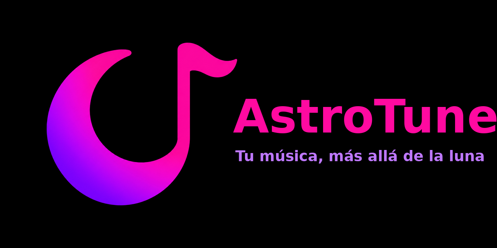

# 🌙 AstroTune · privada y anónima

Reproductor de música **sin cuenta, sin ubicación, sin micrófono, sin anuncios y sin telemetría**. Ningún dato tuyo sale de tu dispositivo. Biblioteca, historial y ajustes viven solo en tu móvil, tele u ordenador.

## ⬇️ Descargas

| Plataforma | Archivo |
|---|---|
| 📱 Android (Android Auto, Chromecast, DLNA) | `*-android-universal.apk` (o el de tu arquitectura; `arm64-v8a` en casi todos) |
| 📱 Android (Rust, beta) | `*-android-rust-beta.apk`: versión nueva en Rust, con la interfaz de cristal líquido |
| 📺 Android TV / Google TV | `*-android-tv.apk` |
| 🪟 Windows 10/11 | `*-windows-x64.exe` |
| 🐧 Linux | `*-linux-x64.deb` · `.rpm` · `.AppImage` |
| 🍎 macOS Apple Silicon (M1 o superior) | `*-macos-apple-silicon.dmg` |
| 🍎 macOS Intel | `*-macos-intel.dmg` |

## ✨ AstroTune para PC (Rust)

Interfaz de **cristal líquido**, pantalla de inicio animada y carátulas que se adaptan a cualquier resolución. Al abrirla por primera vez eliges **idioma (Español / English)**, ves qué garantiza la privacidad, eliges tus artistas y ajustas el nivel de privacidad.

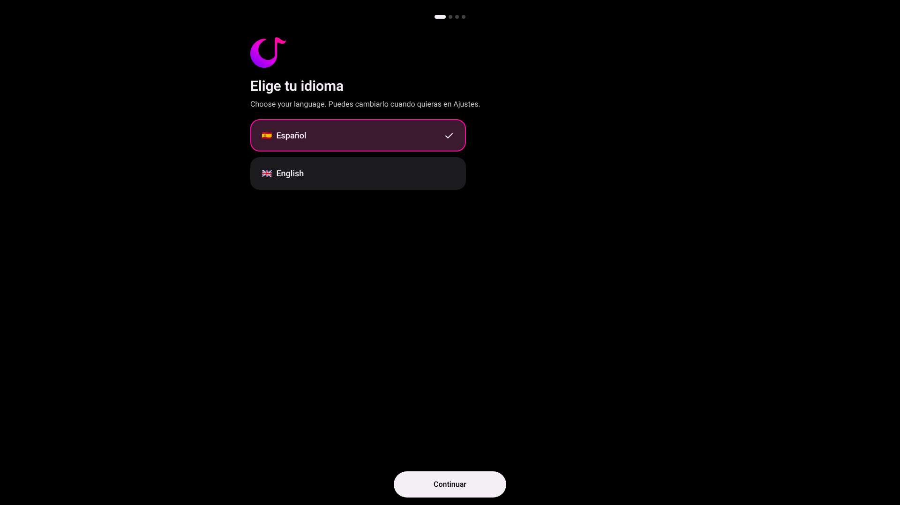
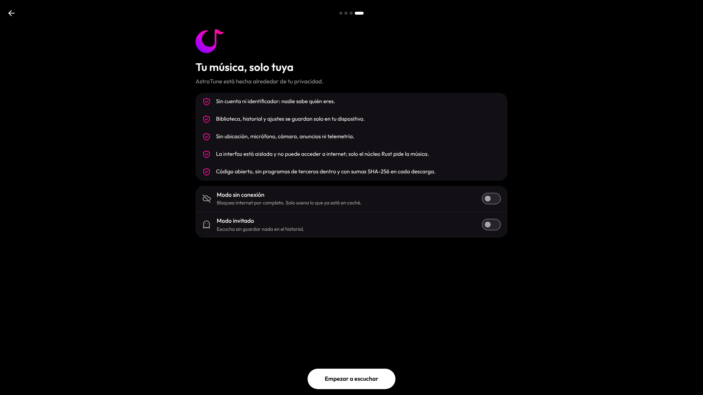
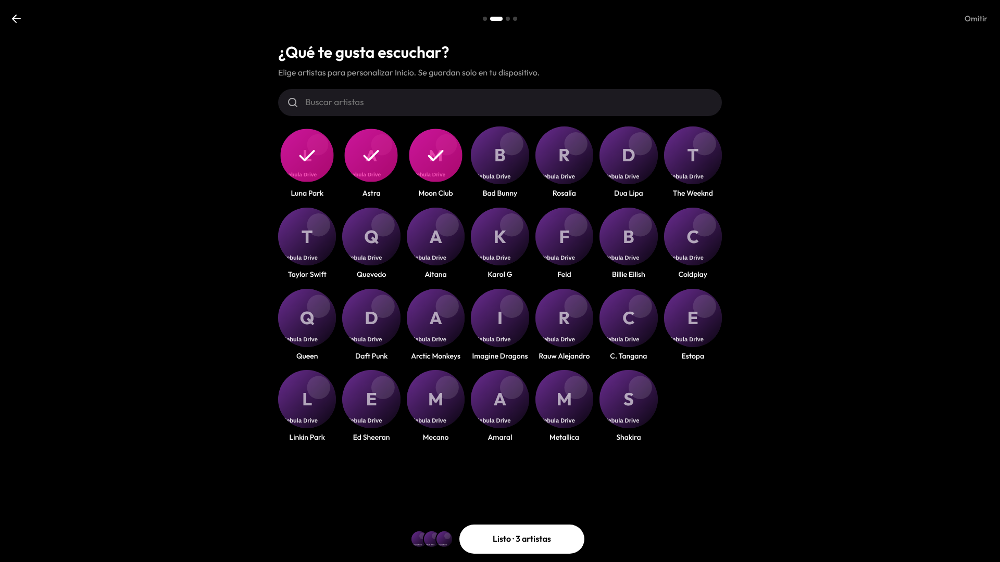
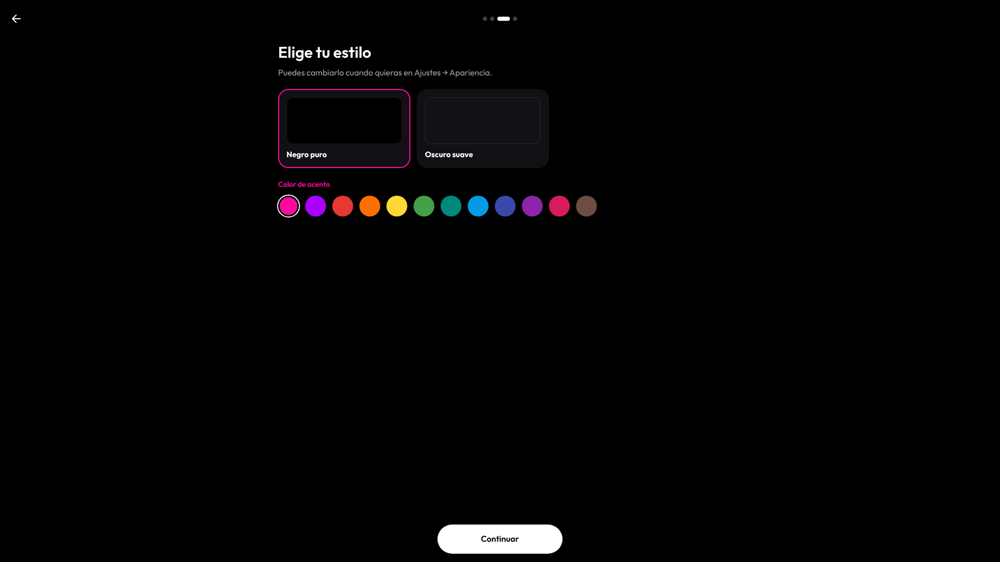
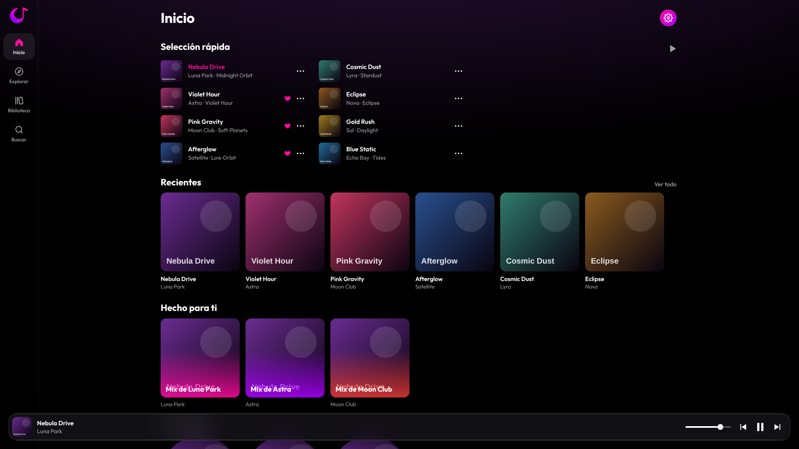
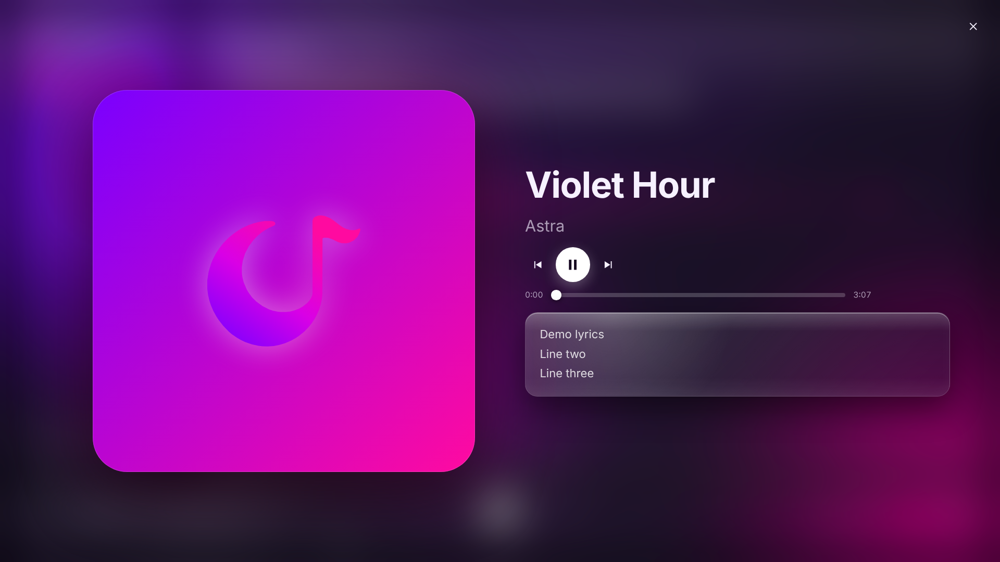
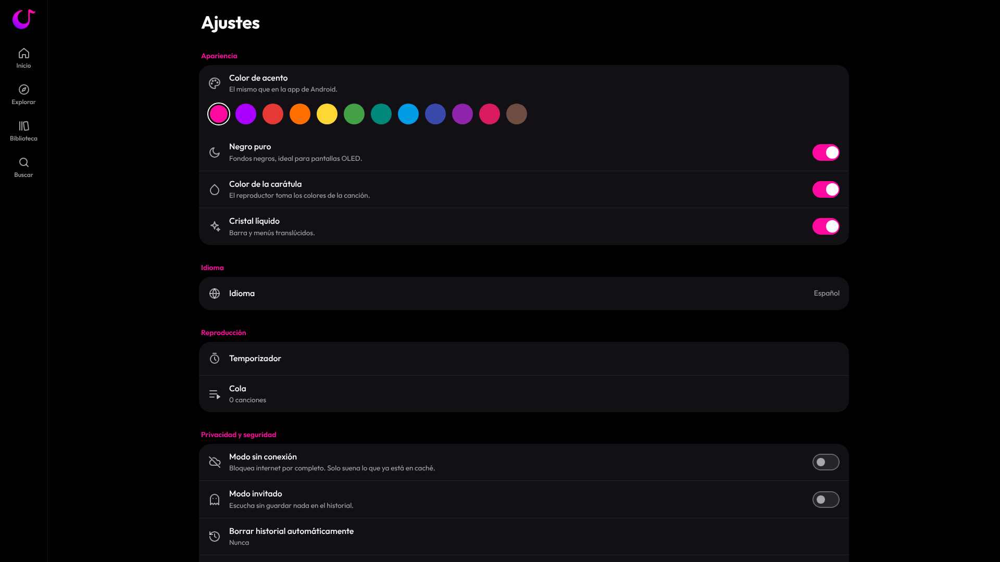

Capturas de la interfaz con datos de ejemplo.

### 📱 En el móvil (Rust)

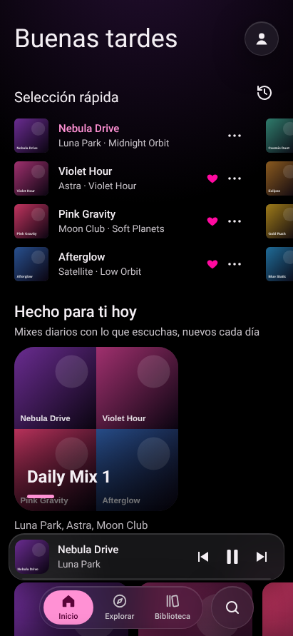
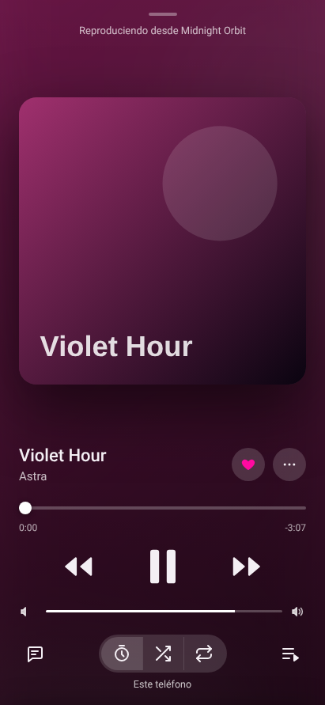
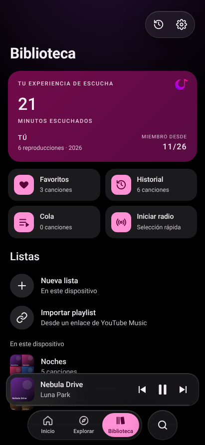
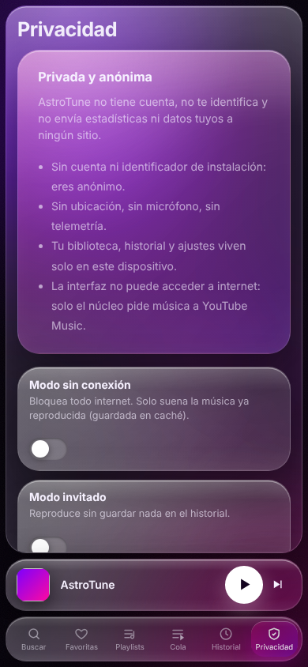

## 🔒 Privacidad y seguridad

- Sin cuenta, sin registro, sin identificador de instalación.
- La interfaz de PC está aislada (CSP estricta) y no puede acceder a internet; solo el núcleo pide la música.
- Modo sin conexión, modo invitado y borrado automático del historial.
- Panel que muestra a qué servidores se conecta la app (la lista no sale de tu equipo).
- Código abierto (GPL-3.0), sin programas de terceros dentro y con `SHA256SUMS.txt` para comprobar cada descarga.

## ⚠️ Importante

Las builds no llevan certificado de pago: **Windows SmartScreen** y **macOS Gatekeeper** pueden avisar (en macOS: clic derecho → Abrir). Los APK de Android están firmados con clave de depuración (desinstala la versión anterior antes de actualizar). La versión **Rust (beta)** reproduce con el WebView y todavía no tiene Android Auto, Chromecast ni controles en la pantalla de bloqueo: para eso usa la de Kotlin. Alexa no admite emisión directa: úsala como altavoz Bluetooth.

Fork de OpenTune.
