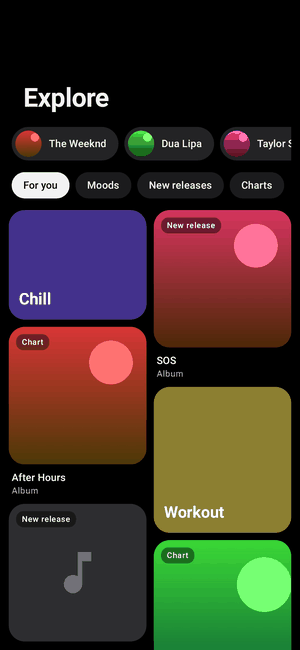
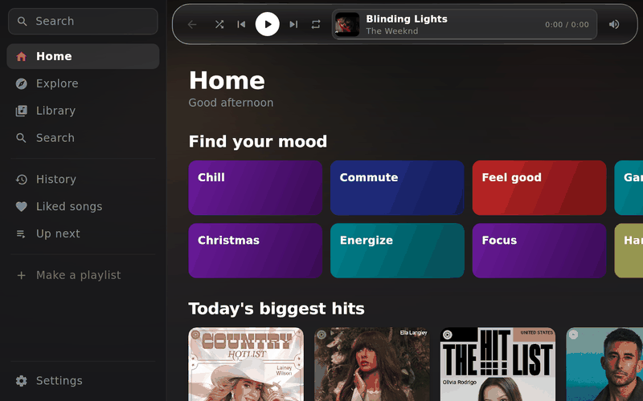

# 🌙 AstroTune 2.0 · privada y anónima

Reproductor de música **sin cuenta, sin ubicación, sin micrófono, sin anuncios y sin telemetría**. Biblioteca, historial y ajustes viven solo en tu móvil, tele u ordenador.

  
  
  

## ⬇️ Descargas

| Plataforma | Archivo |
|---|---|
| 📱 Android (Android Auto, Chromecast, DLNA) | `*-android-universal.apk` (o el de tu arquitectura; `arm64-v8a` en casi todos) |
| 📺 Android TV / Google TV | `*-android-tv.apk` |
| 🪟 Windows 10/11 | `*-windows-x64-setup.exe` · `.msi` · `-portable.zip` |
| 🐧 Linux | `*-linux-amd64.deb` · `*-linux-x86_64.rpm` · `-portable.tar.gz` |
| 🍎 macOS Apple Silicon (M1 o superior) | `*-macos-apple-silicon.dmg` |
| 🍎 macOS Intel | `*-macos-intel.dmg` |

## 🛠️ 2.0.3

- **PC ya no se cierra al bajar** por las páginas (el cristal líquido se dibujaba dentro de sí mismo).
- **Windows**: fuera los botones de cerrar, maximizar y minimizar de Windows que asomaban a la derecha sin poder pulsarse; se usan los de la app, arriba a la izquierda.

## 🛠️ 2.0.2

- **PC en español** por defecto (sigue el idioma del ordenador) y con selector de idioma en Ajustes → Apariencia.
- **Liquid Glass en PC**: la barra del reproductor es una cápsula flotante de cristal líquido que dobla lo que pasa por debajo, como en el móvil.
- **Windows**: arreglada la letra rara (salía Times New Roman); ahora usa Segoe UI.
- **Instalador de Windows sin permiso de administrador**: se instala solo para tu usuario, sin el aviso de un .msi con nombre raro.

## 🛠️ 2.0.1

- **Letras palabra a palabra**: ya no salen las palabras pegadas ("Quememueroportide..."); se recuperan los espacios.
- **Nueva página Privacidad y seguridad** en Ajustes: bloqueo de la app, ocultar en recientes, modo invitado, sin conexión, borrado del historial y qué servidores se usan.
- **Vincular un dispositivo**: Ordenador explica AstroTune para PC; fuera el reproductor web y los enlaces de OpenTune.
- **Acerca de**: un crédito a OpenTune sin enlaces; fuera Discord, estrella en GitHub, donaciones y avisos.

## ✨ Novedades de la 2.0

- **AstroTune para PC, hecha desde la app de Android.** Ya no hay versión en Rust: la de Windows, macOS y Linux compila el mismo código que el móvil (YouTube Music, letras de todas las fuentes, ajustes, mixes diarios, estadísticas) y se ve igual: dock y barra lateral con cristal, reproductor con el color de la carátula, letras sincronizadas, cola, radio, complementos de audio sin pérdida (FLAC), Discord y Last.fm.
- **Reproduce como el móvil.** El audio se pide con las mismas identidades y en el mismo orden que la app de Android, cada enlace se prueba antes de usarlo y, si YouTube corta a mitad, sigue desde el mismo punto con un enlace nuevo.
- **Volumen al enviar**: con Google Home, Chromecast o DLNA, los botones de volumen del móvil suben y bajan el altavoz.
- Arreglado que algunas canciones se saltaran a mitad (SponsorBlock y reintentos).

## 🔒 Privacidad y seguridad

- Sin cuenta, sin registro, sin identificador de instalación.
- Modo sin conexión, modo invitado y borrado automático del historial.
- Código abierto (GPL-3.0) y `SHA256SUMS.txt` para comprobar cada descarga.

## ⚠️ Importante

Las builds no llevan certificado de pago: **Windows SmartScreen** y **macOS Gatekeeper** pueden avisar (en macOS: clic derecho → Abrir). Los APK de Android están firmados con clave de depuración (desinstala la versión anterior antes de actualizar). Alexa no admite emisión directa: úsala como altavoz Bluetooth.
